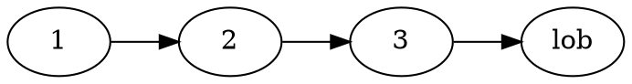
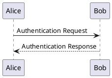
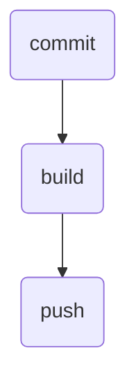
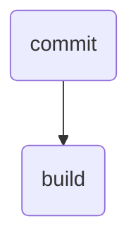

<div align="center">


# Renderknecht

*Render Markdown files into polished PDFs with pandoc and Eisvogel.*

[](LICENSE)
[](https://github.com/Embedded-Focus/renderknecht/actions/workflows/ci.yml)
[](https://github.com/Embedded-Focus/renderknecht/actions/workflows/security.yml)
[](https://github.com/Embedded-Focus/renderknecht/security/dependabot)
[](pyproject.toml)
[](https://flask.palletsprojects.com/)
[](https://pandoc.org/)
[](https://podman.io/)
[](https://docs.astral.sh/uv/)
[](https://github.com/Embedded-Focus/renderknecht/commits/main)

**[Quick Start](#quick-start)** ·
**[Per-user Resources](#per-user-resources)** ·
**[Markdown Front Matter](#markdown-front-matter)** ·
**[Diagrams](#diagrams)** ·
**[Container Stack](#container-stack-hedgedoc--renderknecht)** ·
**[Resource Overrides](#advanced-resource-overrides)**

</div>

Renders Markdown files into beautiful PDFs via [pandoc](https://pandoc.org/) and the
[eisvogel](https://github.com/Wandmalfarbe/pandoc-latex-template) LaTeX template.

All tooling (pandoc, LaTeX, graphviz, and Chromium for Mermaid) runs inside a
container. You need nothing on your machine beyond podman.

## Quick start

**1. Build the image** (once):

```sh
make build              # uses podman by default
make build RUNTIME=docker  # use Docker instead
```

**2. Install** (gets both `renderknecht` and `renderknecht-wrapper`):

```sh
uv tool install -e .
```

**3. Render**:

```sh
renderknecht-wrapper < input.md > output.pdf
```

The wrapper always mounts the **current working directory** read-only into the
container (`/work`), so relative image references in the Markdown resolve
correctly as long as the images live alongside the input file:

```sh
cd /my/project
renderknecht-wrapper < report.md > report.pdf   # images in /my/project/ work
```

## Per-user resources

Place custom resources in `~/.config/renderknecht/` (respects `$XDG_CONFIG_HOME`).
The wrapper mounts that directory read-only into the container automatically.

```
~/.config/renderknecht/
├── preamble.yaml   # LaTeX/pandoc front-matter defaults
├── authors.yaml    # short name → display name mapping
└── logo.pdf        # referenced via titlepage-logo in front matter
```

Any file present there takes priority over the bundled defaults.

## Markdown front matter

Renderknecht merges the default preamble with the document's YAML front matter.
The document always wins over preamble defaults. Example:

```yaml
---
title: My Document
author:
  - rainer
date: 2026-03-06
titlepage-logo: logo.pdf
---
```

Authors listed in `authors.yaml` are expanded to their full display names automatically.

## Pinned versions

`Dockerfile.renderknecht` fixes every part of the toolchain. The base image is
Debian trixie at an image digest, and all apt packages come from one Debian
snapshot date. Each download carries a version and a SHA-256 checksum. The build
checks the checksum before it installs the download, and it stops when a checksum
does not match.

| Part | Pin | How |
|------|-----|-----|
| Base image | `debian:trixie-slim` | image digest in the `FROM` line |
| apt packages | one snapshot date | `SNAPSHOT_DATE` |
| graphviz, librsvg, texlive, python3 | exact versions | version suffix on each package |
| uv | 0.13.6 | `UV_VERSION`, `UV_SHA256` |
| pandoc | 3.13 | `PANDOC_VERSION`, `PANDOC_SHA256` |
| pandoc-crossref | 0.3.26 | `PANDOC_CROSSREF_VERSION`, `PANDOC_CROSSREF_SHA256` |
| Eisvogel template | 3.5.1 | `EISVOGEL_VERSION`, `EISVOGEL_SHA256` |
| Node.js | 26.12.1 | `NODE_VERSION`, `NODE_SHA256` |
| mermaid-cli | 12.0.0 | `MERMAID_CLI_VERSION` |
| mermaid | 12.2.0 | `MERMAID_VERSION` |

To change one part, edit only its version and checksum, then build and check a few
PDFs. To take in security updates for the apt packages, change `SNAPSHOT_DATE` and
build. `uv sync --locked` also stops the build when `uv.lock` no longer matches
`pyproject.toml`.

pandoc-crossref is built for one pandoc version, so change it together with pandoc.
The build renders one small document at the end. It does that through
`render_markdown`, so preamble.yaml, the pandoc filters and the template all run. If
they do not fit together, the build stops there.

The newest mermaid-cli release is 12.0.0. It asks for `mermaid ^12.0.0`, so the image
installs mermaid 12.2.0 next to it. A test makes sure that `mmdc` loads that copy. The
npm packages carry no checksum in the Dockerfile, and npm picks the newest build of each
one. npm makes sure that each package it downloads is intact. The set of npm packages is
still not fixed.

The Chrome build that `mmdc` starts comes from the puppeteer version inside
mermaid-cli, so the mermaid-cli version sets it. The build renders one Mermaid
diagram, so a broken browser stops the build.

## Diagrams

A fenced code block in `graphviz`, `plantuml` or `mermaid` produces a diagram in the PDF.
Renderknecht renders the block instead of printing it as code:

`````markdown





`````

Write a caption in square brackets after the tool name. Add a LaTeX image attribute
after the caption, behind a pipe character, for example `|height=90%`:

`````markdown

`````

| Tool | Renderer | Output | Works with renderknecht-wrapper? |
|------|----------|--------|--------------------------------------|
| `graphviz` | `dot` from the graphviz package | SVG | yes |
| `plantuml` | the `plantuml` service in `compose.yaml` | SVG | no |
| `mermaid` | `mmdc` with Chromium | PDF | yes |

When you render with `renderknecht-wrapper`, the `plantuml` service does not answer.
That service only exists inside the compose network.

A Mermaid label must be plain text. HTML inside a label, for example `<b>bold</b>`, does
not work. Mermaid renders to a PDF and not to an SVG, because librsvg cannot convert
Mermaid SVG. `renderers/pandoc.py` gives the reason.

## Container stack (HedgeDoc + renderknecht)

```sh
podman compose up
```

Starts HedgeDoc, PlantUML, Caddy, and the renderknecht web service. The renderknecht
service auto-detects whether it is running in render mode (stdin pipe) or serve mode
(no stdin / detached).

The HedgeDoc uploads volume is shared with the renderknecht service, so images
uploaded to HedgeDoc are embedded in the PDF automatically — no additional
configuration required.

## Advanced: resource overrides

The wrapper exposes the same override mechanism as the container directly:

| Mechanism | Description |
|-----------|-------------|
| `~/.config/renderknecht/` | Per-user XDG config dir (auto-mounted by wrapper) |
| `RESOURCES_DIR=/path` | Mount an arbitrary directory; overrides XDG |
| `PREAMBLE_YAML=/path` | Override just the preamble (highest priority) |
| `AUTHORS_YAML=/path` | Override just the authors map (highest priority) |
| `MERMAID_ARGS` | Extra arguments for `mmdc`, for example to change the page fit. You can use this inside the container only |
| `MERMAID_PUPPETEER_CONFIG` | Path to a different puppeteer configuration file. You can use this inside the container only |

```sh
podman run --rm -i \
    -v /my/project:/resources:ro \
    -e RESOURCES_DIR=/resources \
    renderknecht:latest < input.md > output.pdf
```

Override the image name used by the wrapper:

```sh
RENDERKNECHT_IMAGE=renderknecht:dev renderknecht-wrapper < input.md > output.pdf
```
